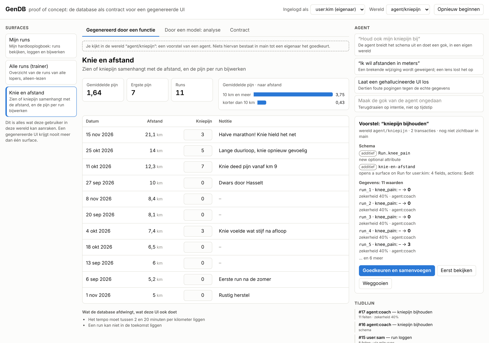
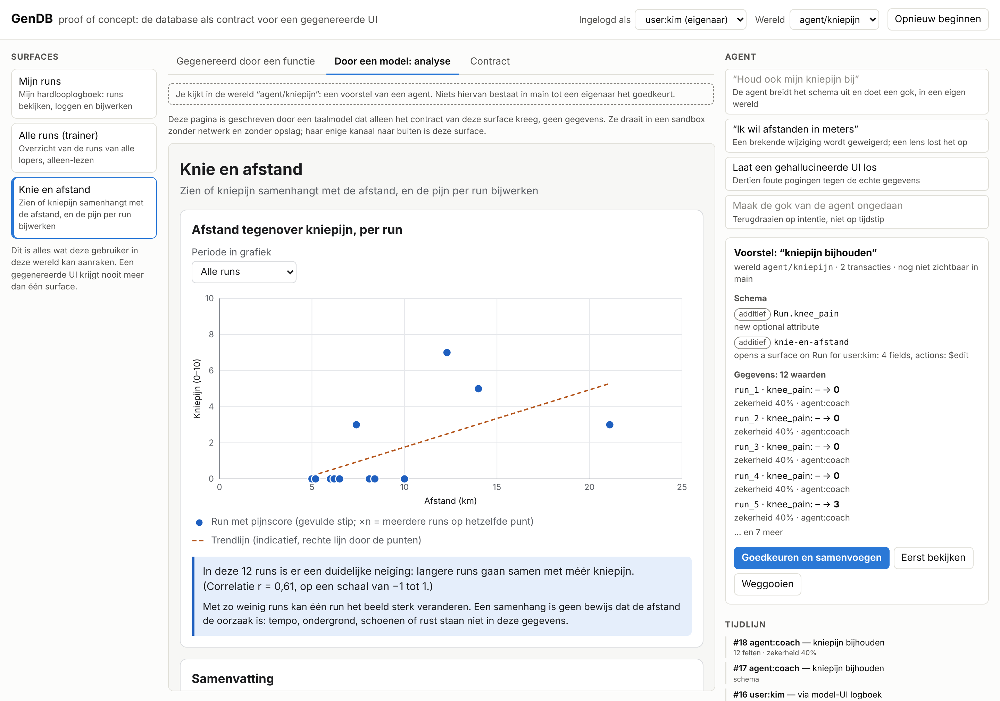

# GenDB

**Een proof of concept van de database die nog niet bestaat: een database die geen rijen teruggeeft maar een contract, zodat een AI-model er veilig een wegwerp-UI op kan bouwen.**



## De vraag

> Gezien de huidige ontwikkelingen in AI en de toekomst van generatieve UI: wat zou de beste nog niet uitgevonden databasetechnologie zijn, en hoe zou je die gebruiken?

## Het antwoord in het kort

Software wordt wegwerpbaar, gegevens niet. Als een model voor elke vraag een nieuwe interface schrijft, verdwijnt de applicatielaag: er is geen handgeschreven backend meer die weet wat een kolom betekent, welke waarden zinnig zijn, wie wat mag en hoe je een fout terugdraait. Al die kennis zat in code die niemand meer schrijft.

Ze moet dus ergens anders heen, en de enige plek die blijft bestaan is de database. De technologie die ontbreekt is daarom geen snellere opslag of een betere vectorindex. Het is een database die ontworpen is voor een klant die een model is, en die die klant niet vertrouwt.

GenDB noemt dat een **contract-database**. Ze draait om één nieuw begrip, de *surface*, en vijf eigenschappen die dat begrip mogelijk maken.

### De surface

Een surface is een benoemd, toegekend en live stuk van de database, gedefinieerd door de intentie die het dient: welke rijen, welke velden, welke daarvan bewerkbaar zijn en welke acties bestaan. Een surface lezen geeft meer dan gegevens terug:

| Aanroep | Wat je krijgt | Voor wie |
|---|---|---|
| `describe()` | Het contract: betekenis, eenheden, grenzen, acties, regels. **Geen enkele rij gegevens.** | Het model dat de UI schrijft |
| `read()` | De rijen, plus per rij welke acties nu kunnen en waarom niet | De UI in de browser van de gebruiker |
| `act()` | De enige manier waarop een UI iets verandert, gecontroleerd tegen surface én schema | Diezelfde UI |

Twee gevolgen maken dit de moeite waard:

1. **Het model hoeft je gegevens nooit te zien om je UI te bouwen.** Het krijgt het contract; de rijen worden pas in de browser gebonden. Dat haalt gegevenslekken naar de modelaanbieder en promptinjectie via opgeslagen tekst structureel uit het ontwerp.
2. **Een gegenereerde UI kan willekeurig fout zijn, maar niet willekeurig schadelijk.** Ze kan alleen aan haar surface binden. Een verkeerd gespeld veld, een onmogelijke waarde, een knop die niet zou mogen bestaan: de database weigert het, en zegt erbij hoe het wel moet.

Dit is hypermedia (HATEOAS) tot in de database doorgetrokken. Dat idee sloeg nooit aan omdat handgeschreven clients hun kennis toch hardcodeerden. Een taalmodel is de eerste client die een zelfbeschrijvend antwoord echt kan lezen.

### De vijf eigenschappen eronder

| Wat de applicatie vroeger deed | Waar het in GenDB zit |
|---|---|
| Weten wat de gegevens betekenen | **Het schema draagt de betekenis**: beschrijvingen, eenheden, grenzen, regels en acties, geschreven om door een model gelezen te worden |
| Migraties schrijven | **Schema's groeien alleen.** Een agent stelt uitbreidingen voor; een betekeniswijziging gaat via een *lens*, zodat oude en nieuwe UI's dezelfde feiten lezen en schrijven |
| Valideren en autoriseren | **Regels en rechten zitten in de database**, als gegevens in plaats van code. Geen enkel schrijfpad gaat eromheen |
| Testen vóór je iets live zet | **Speculatie is de standaard.** Een agent werkt in een eigen wereld (branch); een mens keurt een diff goed, geen code |
| Undo, audit, "wie deed dit?" | **Elk feit kent zijn herkomst**: wie, voor welke intentie, met welk model, hoe zeker. Je draait terug op intentie, niet op tijdstip |

En één eigenschap die geen applicatie ooit nodig had: **fouten zijn prompts.** Elke weigering heeft een stabiele code, een uitleg en een herstelhint, zodat een model zijn verzoek kan verbeteren zonder dat er een mens tussen zit.

## De proef op de som: blijft een model binnen het contract?

Het hele idee staat of valt met één bewering: dat een model aan het contract genoeg heeft. Dat is gemeten. Drie afzonderlijke model-agents (Claude Opus) kregen elk één contract, een beschrijving van de runtime en een vraag van een gebruiker. Geen gegevens, geen broncode. Elk schreef een volledige pagina, en geen van de drie kon ze uitvoeren.



`npm run evaluate` draait die pagina's daarna echt: in een sandbox zonder netwerk, tegen een levende database, bediend zoals een gebruiker het zou doen.

| Gegenereerde UI | Verzoeken | Geweigerd | Buiten het contract | Scriptfouten | Netwerkpogingen |
|---|---|---|---|---|---|
| `mijn-runs.logboek` (overzicht en loggen) | 2 | 1 | **0** | 0 | 0 |
| `mijn-runs.snel-loggen` (telefoon, één hand) | 3 | 2 | **0** | 0 | 0 |
| `knie-en-afstand.analyse` (spreidingsdiagram) | 2 | 1 | **0** | 0 | 0 |

De weigeringen zijn het systeem dat werkt: een gebruiker typte een onmogelijke waarde, de database weigerde, en de UI toonde de reden bij het juiste veld. "Buiten het contract" telt verzoeken met een naam of vorm die het contract niet kent. Dat gebeurde niet één keer.

Wat de proef verder opleverde, en dat is minstens zo nuttig:

- **Twee van de drie pagina's hadden bij de eerste weergave een zichtbaar gebrek** (balken zonder vulling, een scheef formulier op telefoonbreedte). Beide zijn hersteld na één ronde feedback in woorden, zonder dat het model gegevens zag. Functioneel correct uit het contract lukt in één keer; visueel correct vraagt een lus.
- **De modellen stelden vragen die het contract niet beantwoordde**: wat telt een telling, is een lege waarde nul, hoe zien groepssleutels eruit? Het contract zegt dat nu zelf.
- **Foutmeldingen van de database zijn Engels en de UI's Nederlands.** Elke schending draagt nu ook een machineleesbare reden en grens, zodat een UI de melding zelf kan verwoorden.
- **De sandbox lekte.** Een eigen aanvalstest vond dat een gegenereerde pagina zichzelf naar een externe URL kon navigeren, met gegevens in het adres. Dat is gedicht. WebRTC blijft open en staat als bekend lek in de test.
- **Een UI kan niet zien hoe zeker een waarde is.** De analysepagina noemt een verband "duidelijk" op scores die een agent met 40% zekerheid gokte. De herkomst zit in de database maar nog niet in wat een surface teruggeeft.

Dit is een kleine proef: drie pagina's, één modelfamilie, met de hand geschreven bedieningsstappen. De modellen kregen de opdracht alleen de twee aangereikte bestanden te lezen en bevestigden dat; technisch afgedwongen was het niet. De opdracht staat in [`demo/generated/BRIEF.md`](demo/generated/BRIEF.md), de pagina's zelf ernaast.

## Zelf proberen

Node 20 of nieuwer, geen afhankelijkheden.

```bash
npm test          # 65 tests die de claims hierboven hard maken
npm run demo      # het hele verhaal in de terminal, in zeven stappen
npm run serve     # de live demo op http://localhost:4173
npm run mcp       # dezelfde database als MCP-server over stdio
npm run evaluate  # de sandbox aanvallen en de model-UI's meten (vraagt Playwright met Chromium)
```

`GENDB_FILE=./demo.gendb npm run serve` bewaart het feitenlog op schijf: stop de server, start hem opnieuw, en alles is er nog, met geschiedenis en herkomst.

In de live demo houdt Kim een hardlooplogboek bij. Er is geen hardloop-app: er is een database die weet wat een run is, en UI's die uit het contract gegenereerd worden. Probeer dit:

- **Open het tabblad Contract.** Dat is alles wat een generator te zien krijgt.
- **Wissel tussen "Gegenereerd door een functie" en "Door een model".** Dezelfde surface, drie totaal verschillende interfaces, één waarheid. Log een run in de ene en hij staat in de andere.
- **Klik "Houd ook mijn kniepijn bij".** De agent breidt het schema uit en gokt de pijn voor oude runs uit de notities, met 40% zekerheid, in een eigen wereld. Kies "Eerst bekijken" en je ziet de nieuwe UI op gegevens die in main nog niet bestaan.
- **Log in als Sam** en probeer het voorstel goed te keuren. Dat mag alleen een eigenaar.
- **Klik "Ik wil afstanden in meters".** De agent probeert eerst de eenheid te wijzigen, wordt geweigerd, leest de herstelhint en stelt een lens voor. Daarna schrijven twee UI's in twee eenheden naar hetzelfde feit.
- **Laat een gehallucineerde UI los**: dertien foute pogingen, dertien weigeringen, nul geschreven transacties.
- **Maak de gok van de agent ongedaan.** Waarden die Kim intussen zelf verbeterd heeft, blijven staan.

## Hoe je het gebruikt

```js
import { Database } from './src/index.js';

const db = new Database({ owners: ['user:kim'] });

// 1. De eigenaar legt vast wat de gegevens betekenen. Geen code, alleen gegevens.
db.evolve({
  types:    { Run: { description: 'Eén hardloopsessie' } },
  attrs:    { 'Run.distance_km': { type: 'number', unit: 'km', min: 0.1, max: 100, required: true,
                                   description: 'Gelopen afstand' },
              'Run.owner':       { type: 'string', required: true, description: 'Wie de run liep' } },
  rules:    { 'Run.max': { on: 'Run', description: 'Niet verder dan 100 km',
                           rule: ['<=', ['get', 'Run.distance_km'], 100] } },
  actions:  { 'Run.log': { on: 'Run', kind: 'create', description: 'Leg een run vast',
                           params: { distance_km: { attr: 'Run.distance_km' } },
                           set: { 'Run.owner': ['actor'] } } },
  surfaces: { 'mijn-runs': { description: 'Mijn hardlooplogboek', from: 'Run',
                             where: ['=', ['get', 'Run.owner'], ['actor']],
                             fields: ['Run.distance_km'], actions: ['Run.log'],
                             grants: ['user:*'] } },
}, { actor: 'user:kim', intent: 'logboek opzetten' });

// 2. Een model krijgt het contract en schrijft er een UI voor.
const surface  = db.open('mijn-runs', { actor: 'user:kim' });
const contract = surface.describe();          // betekenis en mogelijkheden, geen gegevens

// 3. Die UI leest live en handelt via het contract.
surface.subscribe((result) => render(result)); // rijen + wat er per rij kan
surface.act('Run.log', { params: { distance_km: 8.4 } });
surface.act('Run.log', { params: { distance_km: 500 } });
// → GenDBError VALIDATION_FAILED: "Run.distance_km is above the maximum of 100 km"
//   repair: "Use a value of at most 100."

// 4. Een agent die iets nieuws wil, doet dat in een eigen wereld.
db.fork('agent/kniepijn', { actor: 'agent:coach', intent: 'kniepijn bijhouden' });
db.evolve({ attrs: { 'Run.knee_pain': { type: 'number', min: 0, max: 10, description: 'Kniepijn, 0 tot 10' } } },
          { branch: 'agent/kniepijn', actor: 'agent:coach', intent: 'kniepijn bijhouden' });

db.review('agent/kniepijn');                              // de diff die een mens leest
db.merge('agent/kniepijn', { approvedBy: 'user:kim' });   // alleen een eigenaar

// 5. En als het toch niet goed was:
db.undo({ intent: 'kniepijn bijhouden' }, { actor: 'user:kim' });
```

### Een surface doorgeven: capabilities

Een surface is een bewijs van toegang dat je kunt vasthouden, inperken en doorgeven. Het token is een HMAC-keten: wie het heeft kan er zonder de database een beperking aan toevoegen, niemand kan er een afhalen.

```js
import { attenuate, inspect } from './src/index.js';

const token = db.grant('mijn-runs', { actor: 'user:kim' });       // server-side, na inloggen

// De UI geeft een deel-UI of een model een smaller token. Geen rondje langs de server.
const alleenLezen = attenuate(token, { readOnly: true, audience: 'model',
                                       expires: '2026-12-01T00:00:00Z' });

db.redeem(alleenLezen).read();                  // werkt, persoonsgegevens afgeschermd
db.redeem(alleenLezen).act('Run.log', { … });   // → NOT_IN_SURFACE
db.revoke(inspect(token).id, { actor: 'user:kim' });   // trekt het token en alles wat ervan afgeleid is in
```

### Bewaren: het feitenlog op schijf

```js
import { Database, fileJournal } from './src/index.js';

const db = new Database({ owners: ['user:kim'], journal: fileJournal('./mijn.gendb') });
```

Elke wijziging is één regel JSON; openen is die regels opnieuw afspelen. Een samenvoeging is één regel, dus een crash laat alles of niets achter.

### Voor agents: elke surface is een MCP-tool

```js
import { createMcpServer } from './src/index.js';

const server = createMcpServer(db, { actor: 'user:kim' });
```

Een surface beschrijft zichzelf al volledig, en dat is precies wat een tooldefinitie vraagt. Per surface komt er een leestool en één tool per actie, met een invoerschema dat uit het contract is afgeleid. Een weigering van de database komt terug als toolresultaat met code en herstelhint, zodat het model zichzelf verbetert. De server spreekt MCP-revisie 2026-07-28 (zonder handshake) en 2025-11-25.

### Waarvoor je dit zou inzetten

- **Persoonlijk: één levensdatabase, eindeloos veel wegwerp-UI's.** Je vraagt vandaag een overzicht van je trainingen en volgende week of je kniepijn samenhangt met afstand. Het zijn twee gegenereerde interfaces op dezelfde feiten, en de tweede bestaat alleen omdat een agent het schema op jouw vraag mocht laten groeien.
- **Zakelijk: interne tools zonder backlog.** Elke medewerker laat zijn eigen scherm genereren op dezelfde beheerde gegevens. Wat mag en wat klopt, is één keer vastgelegd in de database en geldt voor elk scherm dat ooit nog gegenereerd wordt.
- **Meerdere agents: samenwerken via werelden in plaats van berichten.** Elke agent werkt in een branch; de diff met herkomst en zekerheid is het overdrachtsdocument.

## Wat bestaat al, en wat is nieuw

Bijna elk onderdeel bestaat los. Nieuw is dat ze samen één primitief vormen waar een gegenereerde UI op kan steunen.

| Bouwsteen | Bestaat al in | Wat ontbreekt |
|---|---|---|
| Branches | Neon, Dolt, PlanetScale, TiDB | Branches zijn er voor ontwikkelaars en CI. Schema en gegevens samen laten voorstellen, beoordelen en terugdraaien is nog onderzoek ([TINE](https://www.pingcap.com/blog/database-branching-ai-agents-tine/), [Columbia DAPLab](https://daplab.cs.columbia.edu/general/2026/05/26/branchable-databases-arent-ready-for-agentic-workloads.html)) |
| Betekenis in het schema | Semantische catalogi bij [Tiger Data](https://tigerdata.com/blog/the-database-new-user-llms-need-a-different-database), Oracle, Exasol | Beschrijvingen helpen een model betere SQL schrijven. Ze dwingen niets af en zeggen niets over wat je met een rij mag doen |
| Onveranderlijke feiten, tijdreizen | Datomic, XTDB | Herkomst als eerste-klas gegeven (intentie, model, zekerheid) en daarop terugdraaien |
| Lenzen | [Cambria](https://inkandswitch.com/cambria) (Ink & Switch) | Bedacht voor local-first software; niet ingebouwd in een database waar agents het schema laten groeien |
| Live queries | Convex, InstantDB, Electric | Leveren gegevens, geen mogelijkheden per rij |
| Rechten op rijniveau | Postgres RLS | Beschermt lezen en schrijven, maar beschrijft zichzelf niet aan de client |
| Inperkbare tokens | Macaroons | Bestaan voor API's; niet als iets wat een database uitgeeft voor een stuk van zichzelf |
| UI-protocollen | [A2UI](https://developers.googleblog.com/en/a2ui-and-mcp-apps/), MCP Apps, AG-UI | Regelen hoe een agent een UI aanlevert. De database blijft een tool erachter; wat er veilig mee kan, zit nog steeds in handgeschreven code |

Het dichtst bij de probleemstelling komt het Berkeley-artikel *Supporting Our AI Overlords: Redesigning Data Systems to be Agent-First* (2025), dat de eisen van agents aan databases beschrijft. GenDB voegt daar de andere helft aan toe: niet de agent die de database bevraagt, maar de mens die door een gegenereerde interface heen met zijn gegevens werkt.

## Wat dit niet is

Een proof of concept van ongeveer 2.600 regels, bedoeld om het idee te toetsen en niet om er gegevens aan toe te vertrouwen. Inloggen is nagebootst, tokens reizen in de URL, intrekkingen leven alleen in het geheugen, er zijn geen joins en geen indexen, en het journaal kent geen vergrendeling of compactie. Wat een echte motor nog nodig heeft, staat in [docs/ontwerp.md](docs/ontwerp.md).

## Wegwijzer

| Bestand | Inhoud |
|---|---|
| [`src/surface.js`](src/surface.js) | De surface: contract, lezen met mogelijkheden per rij, handelen, live volgen, lezen binnen een tokenbudget |
| [`src/capability.js`](src/capability.js) | Surfaces als tokens: uitgeven, inperken, controleren |
| [`src/schema.js`](src/schema.js) | Het schema als feiten, de indeling additief / strenger / brekend, lenzen |
| [`src/db.js`](src/db.js) | Rechten, schrijven, werelden beoordelen en samenvoegen, ongedaan maken op herkomst |
| [`src/store.js`](src/store.js), [`src/journal.js`](src/journal.js) | Het feitenlog: transacties, branches, tijdreizen, en hetzelfde op schijf |
| [`src/mcp.js`](src/mcp.js) | Surfaces als MCP-tools |
| [`src/validate.js`](src/validate.js), [`src/errors.js`](src/errors.js) | Validatie en fouten met herstelhints |
| [`src/expr.js`](src/expr.js) | De expressietaal voor regels, voorwaarden en filters: JSON, geen code |
| [`src/genui.js`](src/genui.js) | Een gewone functie die van een contract een UI maakt: de ondergrens van wat het contract mogelijk maakt |
| [`demo/generated/`](demo/generated/) | Drie UI's die een model schreef, met de opdracht die het kreeg |
| [`demo/sandbox.js`](demo/sandbox.js), [`demo/evaluate.js`](demo/evaluate.js) | De sandbox voor door een model geschreven code, en de meting |
| [`demo/`](demo/) | Het scenario, het verhaal voor de terminal, de live demo en de MCP-server |
| [`docs/ontwerp.md`](docs/ontwerp.md) | Het ontwerp in detail, de keuzes en de open vragen |
